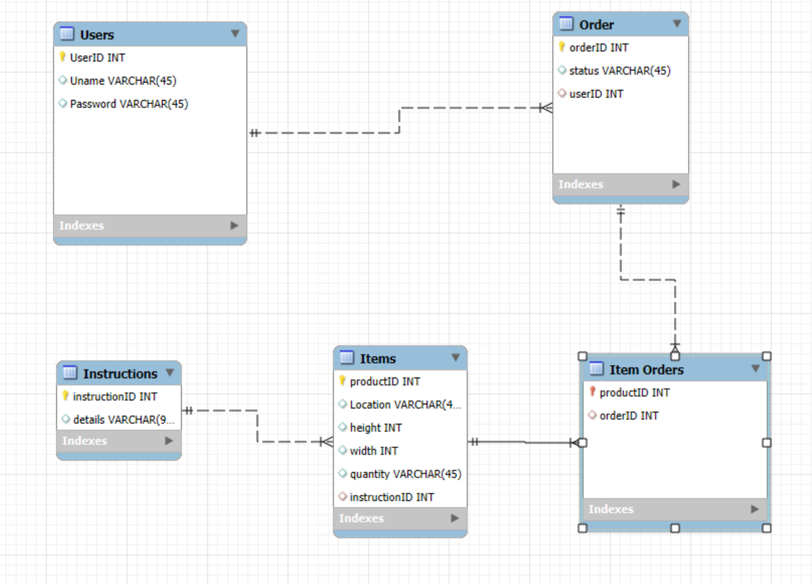

# Website Overview: How the Website, Database, and Robot Work Together

This document explains the Etown Robotic Delivery Systems website: what each page does, how the PHP code is organized, how the database is laid out, and how an order placed on the website ends up being carried out by the robot.

> **Status:** The login, registration, ordering, profile, and about pages are working. The home page (`website/index.php`) is still a placeholder that lists the project requirements and will be replaced with a real landing page.

## The big picture

There are three parts, and they only talk to each other in fixed ways:

```
  Customer's browser                Web server (PHP, Hostinger)               Robot (Python on the LIMO)
 ┌──────────────────┐   HTTPS    ┌───────────────────────────────┐   HTTPS   ┌──────────────────────────┐
 │ website/*.php    │ ─────────> │ website/   pages              │ <──────── │ src/run_robot/robot.py   │
 │ (forms, tables)  │ <───────── │ api/robot/ robot endpoints    │ ────────> │ polls every 3 seconds    │
 └──────────────────┘            │ includes/  shared PHP code    │           └──────────────────────────┘
                                 └───────────────┬───────────────┘
                                                 │ PDO (SQL)
                                          ┌──────▼──────┐
                                          │  MySQL DB   │
                                          └─────────────┘
```

- The **customer** only ever uses the website pages.
- The **robot** only ever calls the robot API (`api/robot/`). It never connects to the database and never sees the database password.
- Only the **server's PHP code** reads and writes MySQL.

The database is the hand-off point. The website writes a `Pending` order, and the robot later asks the API for it.

## Folder layout

```
api/
└── robot/index.php          Robot API (next-order, update-status)
includes/
├── bootstrap.php            Loaded by every page: config, DB, repositories, sessions, helpers
├── config.php               Server secrets: DB login and $robotApiKey (gitignored, not in the repo)
├── config_sample.php        Template for config.php
├── RDSdb.php                Small PDO wrapper used for all SQL
└── repositories/
    ├── UserRepo.php         UserRepository: find and create users
    ├── ItemRepo.php         ItemRepository: list items, look up one item
    └── OrderRepo.php        OrderRepository: create orders, list them, change status
website/
├── index.php                Home page (in progress)
├── login.php                Log in
├── register.php             Create an account
├── logout.php               Log out (POST only)
├── order.php                Place an order and see your orders
├── profile.php              Account details, order counts, and order lists
├── about.php                Team page
├── Classes/                 Shared page pieces: header.php, footer.php, orders_list.php
├── Styles/                  CSS for each page
└── headshots/, logo.png     Images
```

## How a page request works

Every page starts the same way:

```php
require_once __DIR__ . '/../includes/bootstrap.php';
```

`bootstrap.php` then:

1. Loads `config.php` (database login and robot API key).
2. Loads `RDSdb.php`, the database wrapper.
3. Loads the three repository classes.
4. Starts the PHP session so the site knows who is logged in.
5. Defines helper functions:
   - `isLoggedIn()` returns true if `$_SESSION['userID']` is set.
   - `requireLoginPage()` redirects to `login.php` if no one is logged in. Protected pages call it on their first line.
   - `requireRobotKey()` is used only by the robot API (see below).

Pages never write SQL themselves. They call repository methods such as `OrderRepository::create(...)`, and the repositories call `RDSdb`, which uses prepared statements (`?` placeholders) for every query. This keeps SQL in one place and protects against SQL injection.

```
page.php  ──>  Repository class  ──>  RDSdb (PDO prepared statement)  ──>  MySQL
```

Pages share a common layout. `Classes/header.php` draws the navigation bar, which shows **Profile / Logout** when logged in and **Login** when not. `Classes/footer.php` closes the page. Any user-supplied text is printed through `htmlspecialchars()` to prevent cross-site scripting.

## The pages

| Page | Login required | What it does |
|---|---|---|
| `index.php` | No | Home page. **In progress**; currently lists the project requirements. |
| `register.php` | No | Creates an account. Username must be 1–45 characters and not already taken; password must be at least 8 characters. The password is stored with `password_hash()`. On success the user is logged in and sent to the profile page. |
| `login.php` | No | Checks the username and password with `password_verify()`. Shows the same "Invalid username or password" message for either mistake so attackers can't tell which usernames exist. Calls `session_regenerate_id()` on success to prevent session fixation. |
| `logout.php` | No | Clears the session. It only accepts POST (the Logout button is a small form), so a link on another site can't log a user out. |
| `order.php` | Yes | Shows a dropdown of every item (with its handling instruction, if any). Submitting creates a new `Pending` order, then redirects back with a confirmation message. Below the form, the user's orders are listed. |
| `profile.php` | Yes | Shows the username, user ID, counts of total, active, and completed orders, and the same order lists. |
| `about.php` | No | Team members, photos, bios, and LinkedIn links. To edit it, change the `$team` array at the top of the file. |

### Order lists

`order.php` and `profile.php` both include `Classes/orders_list.php`, which prints two tables:

- **Current Orders:** status `Pending`, `Claimed`, or `InProgress`
- **Order History:** everything else (`Delivered`, `Failed`, …)

`OrderRepository::splitActiveAndHistory()` makes this split. Because the robot updates the status in the database, refreshing the page shows the order move from *Current* to *History* once the robot finishes it.

## Database design



| Table | Columns | Purpose |
|---|---|---|
| `Users` | `UserID` (PK), `Uname`, `Password` | Website accounts. `Password` holds a hash, never the plain password. |
| `Order` | `orderID` (PK), `status`, `userID` (FK → Users) | One row per order placed. `status` is what the robot and website both watch. |
| `Item Orders` | `productID` (FK → Items), `orderID` (FK → Order) | Links an order to the items in it. One order can have many items. |
| `Items` | `productID` (PK), `Location`, `height`, `width`, `quantity`, `instructionID` (FK → Instructions) | The things a customer can order. `Location` tells the robot where to drive. |
| `Instructions` | `instructionID` (PK), `details` | Optional handling notes for an item (for example "fragile"). |

Relationships:

- A **user** has many **orders**.
- An **order** has many **item orders**, and each **item order** points to one **item**. This is the many-to-many link between orders and items.
- Many **items** can share one **instruction**.

Notes:

- `Order` and `Item Orders` contain spaces or reserved words, so the SQL writes them in backticks: `` `Order` ``, `` `Item Orders` ``.
- **`Items.Location` must exactly match a key in the robot's code** (`box1`, `box2`, `box3`). It is case-sensitive and spaces matter. A value the robot doesn't recognize makes the order fail instead of the robot guessing where to go.
- PHP's `password_hash()` produces a 60-character hash, so `Users.Password` must be at least `VARCHAR(60)`. The ERD shows `VARCHAR(45)`; the live table should be `VARCHAR(255)` (as in `Updated_ERD.png`), or logins will fail because the stored hash is cut off.
- Placing an order inserts into `Order` and `Item Orders` inside one transaction (`OrderRepository::create`), so you never get an order with no items or items with no order.

## Connecting the website to the robot

### Authentication with an API key

The robot proves who it is by sending a secret key in an HTTP header on every request:

```
X-API-Key: <64-character secret>
```

The same key is stored in two places, and neither should ever be committed to Git:

| Where | Variable |
|---|---|
| Server: `includes/config.php` | `$robotApiKey` |
| Robot: `src/run_robot/robot_config.py` | `API_KEY` |

`api/robot/index.php` calls `requireRobotKey()` before anything else. It compares the header to `$robotApiKey` with `hash_equals()` (a timing-safe comparison). If the key is missing or wrong, the server replies `401 Unauthorized` with an empty body and stops.

To create a new key:

```
php -r "echo bin2hex(random_bytes(32));"
```

Put the result in both files. If the key ever leaks, generate a new one and update both places.

### Robot API endpoints

Base URL: `https://rds.etowndb.com/api/robot/` (keep the trailing slash, or a redirect can turn a POST into a GET).

#### `GET ?action=next-order`

Asks for work. The server:

1. Looks for an order that is already `InProgress`. If the robot crashed or restarted mid-delivery, it gets the same order back.
2. Otherwise takes the **oldest** `Pending` order, changes it to `InProgress`, and returns it.
3. If there is nothing to do, returns `{"order": null}`.

Example response:

```json
{
  "order": {
    "orderID": 4,
    "status": "InProgress",
    "items": [
      {"productID": 1, "name": "Blue ball", "Location": "box1", "height": 4, "width": 4, "instruction": "Fragile"},
      {"productID": 3, "name": "Orange ball", "Location": "box2", "height": 4, "width": 4, "instruction": null}
    ]
  }
}
```

The item list comes from `OrderRepository::getItems()`, which joins `Item Orders`, `Items`, and `Instructions` so the robot gets everything in one response. `instruction` is the `Instructions.details` text, or `null`.

#### `POST ?action=update-status`

Reports that the robot finished an order.

Request body:

```json
{"orderID": 4, "status": "Delivered"}
```

Rules enforced by the server:

| Situation | Response |
|---|---|
| Status is `Delivered` or `Failed`, and the order is `InProgress` | `200` `{"ok": true, "orderID": 4, "status": "Delivered"}` |
| Missing `orderID`, or any other status | `400` |
| Order doesn't exist | `404` |
| Order isn't `InProgress` (for example, already delivered) | `409` |

The robot can only *finish* an order. It cannot set an order back to `Pending` or skip straight from `Pending` to `Delivered`.

Any other action or method returns `404`. Unexpected server errors are written to the server's error log and the robot just gets a generic `500 {"error": "Server error"}`, so internal details are never exposed.

### Order status lifecycle

```
  website (order.php)        robot: next-order          robot: update-status
         │                          │                           │
         ▼                          ▼                           ▼
     Pending  ───────────────>  InProgress  ──────────────>  Delivered
                                    │
                                    └──────────────────────>  Failed
```

| Status | Set by | Shown to the customer as |
|---|---|---|
| `Pending` | Website, when the order is placed | Current order |
| `InProgress` | Server, when the robot asks for work | Current order |
| `Delivered` | Robot, after a successful run | Order history |
| `Failed` | Robot, if any step throws an error (for example an unknown `Location`) | Order history |

### What the robot does with an order

`src/run_robot/robot.py` runs in a loop:

1. Call `next-order`. If there's no order, wait `POLL_SECONDS` (3 seconds) and try again.
2. For each item, look up `item["Location"]` in the `LOCATIONS` table (`box1`, `box2`, `box3`) and run that movement: drive to the box, pick the item with the arm, drive back, and place it in the robot's box.
3. If every item succeeds, send `update-status` with `Delivered`. If anything fails, send `Failed`.

The robot only does one order at a time, and because `next-order` returns the existing `InProgress` order first, a restarted robot picks up where it left off instead of starting a new order.

## End-to-end example

1. A customer registers and logs in. A row is added to `Users`.
2. On `order.php` they choose "Blue ball" and click **Place Order**. Order #4 is created with status `Pending`, and a row links order 4 to that item in `Item Orders`.
3. Within a few seconds the robot calls `GET next-order`. The server marks order #4 `InProgress` and sends back the item with `Location: "box1"`.
4. The customer refreshes their profile. Order #4 is still under **Current Orders**, now showing `InProgress`.
5. The robot drives to box 1, picks up the ball, returns, and drops it in its box.
6. The robot calls `POST update-status` with `Delivered`.
7. The customer refreshes again. Order #4 has moved to **Order History** with status `Delivered`.

## Setting up the website on a new server

1. Upload `website/`, `includes/`, and `api/` to the host, keeping them side by side (the pages load `../includes/bootstrap.php`).
2. Copy `includes/config_sample.php` to `includes/config.php` and fill in `$servername`, `$port`, `$database`, `$username`, `$password`, and `$robotApiKey`.
3. Create the tables from the ERD in MySQL and add rows to `Items` whose `Location` values match the robot's `LOCATIONS` keys.
4. Put the same API key and the server's API URL in the robot's `robot_config.py`.
5. Test the API before running the robot. With a correct key you should get JSON; with a wrong key, `401`:

   ```
   curl -H "X-API-Key: <key>" "https://rds.etowndb.com/api/robot/?action=next-order"
   ```

## Still to do

- Build the real home page (`index.php`).
- Let a customer order more than one item at a time. `OrderRepository::create()` already accepts a list of items; only the form on `order.php` is limited to one.
- Show item names instead of "Item 1, Item 2" in the order tables.
- Automatic page refresh on the profile page so status changes appear without reloading.
